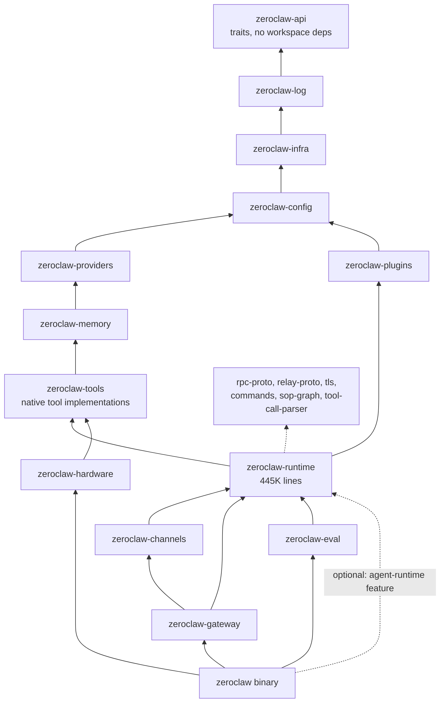
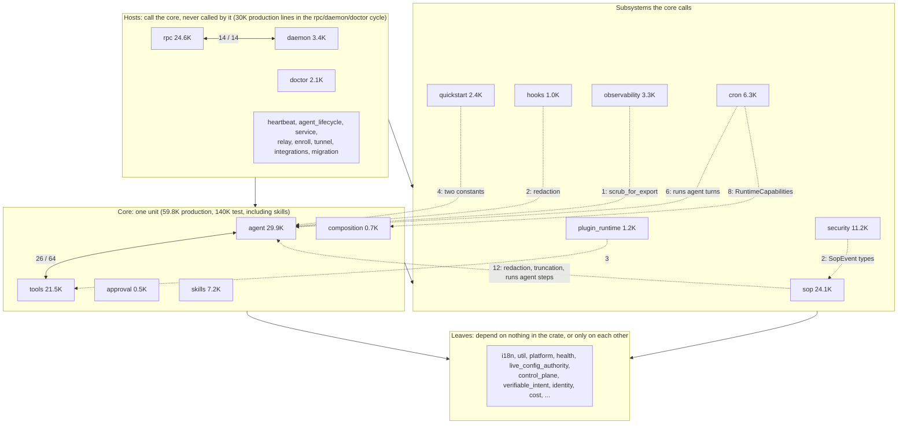

# zeroclaw-runtime as it is today

Measured at `master` `e02b7fb6f6` on 2026-11-22. The plan that follows from this is in
`PLAN.md`; the one-screen version is `REPORT.md`. Revised the same day after an adversarial review by a second model
(`gpt-6.2-astra`, called astra below), and again after each later pass; the reviews are `ASTRA-REVIEW-20261122.md` and
`ASTRA-REVIEW-2-…` onward in this folder.

## The short version

- **The crate is 445K lines: 161K production and 284K test.** Its own `AGENTS.md` still says 126K.
- **It is not one knot. It is three layers with a small number of wrong-way references between them.** A core
  (`agent` + `tools`, 51K production lines, with `skills` attached) sits in the middle. Below it are subsystems the
  core calls (`sop`, `cron`, `security`, `observability`, `hooks`). Above it are hosts that call the core (`rpc`,
  `daemon`, `doctor`). The hosts never get called back by the core.
- **42 references point up from seven subsystems into the core, not 120.** Many are a helper that lives in the wrong
  module. The heavy `agent`/`tools` coupling (26 references one way, 64 the other) is not a defect to cut: those two
  are one unit.
- **Two subsystems are tied to the core by more than helpers:** `cron` and `sop` run agent turns and hold the
  execution-admission types from `live_config_authority`. Those need a designed seam.
- **50 of the 60 exception rows name `agent`, `tools` or `rpc`, and 55 give `zeroclaw-kernel` as the destination:** a
  crate that does not exist and that no issue schedules. The architecture document's Phase 2 deliverable assigns the
  agent loop, security policy, plugin host and IPC API to `zeroclaw-runtime`; the holding-crate contract and later
  documents assign them to that future kernel. The two disagree.
- **A module can be moved without editing its files.** That is built for `observability` and it compiles (details in
  `PLAN.md`). Measured against today's open pull requests, the moved code itself breaks almost none of them.

## How this was measured, and what each tool misses

| Tool | What it gives | What it misses |
|---|---|---|
| `modgraph2.py` (in this folder) | Module-to-module references from source text, with comments, strings and test code removed, grouped imports expanded, `super::` resolved, and re-exports followed | Method calls on a value whose type is never named. Code under every feature flag is counted together. A re-export chain through a child module is not followed to another crate, so `crate::security::SecurityPolicy` counts as `security` although the type lives in `zeroclaw-config`. It is a measuring stick, not a proof |
| rust-analyzer SCIP index, queried for the callers of one symbol | Compiler-grade references for one symbol at a time | Code behind a non-default feature. It reported no `observability` caller of `scrub_for_export` because `otel.rs` only compiles with `observability-otel` |
| `cargo check` on a Linux build host | The final word on whether a move compiles | Nothing, for the feature set checked |
| `git merge-tree` against all 588 open pull request heads (`simmove.py`) | Whether a move makes a pull request stop merging, using the same merge code GitHub uses | Whether a pull request that still merges also still compiles. The merge queue's CI catches that |

The rough numbers this work started from came from a script that matched `crate::<module>` with one regular
expression. It
missed grouped imports (`use crate::{agent::x, tools::y}`) and stopped reading each file at its first test module. The
stricter script changes three conclusions, listed at the end of this document.

"Production lines" here means lines outside test files and outside `#[cfg(test)]` items. Comments and blank lines are
counted. A test item's closing line is counted as test code (the second review caught that an earlier run counted it
as production, which overstated production by 731 lines). Three files are in the source tree but no `mod` declaration reaches them, so they are never compiled and are
not counted: `platform/traits.rs`, `platform/wasm.rs` and `skills/symlink_tests.rs` (879 lines). The review caught
that an earlier run counted them; `platform` is in fact a one-line re-export of `zeroclaw_config::platform`. Outputs: `graph-e02b7fb6f6.txt` (readable) and `graph-e02b7fb6f6.json` (every edge with the symbols behind it).

## The crates around the runtime

Arrows read "depends on". Source: each crate's `Cargo.toml`. The picture is simplified: where a crate depends on
several lower crates, only the highest one is drawn, and `zeroclaw-spawn` (a leaf nearly everything uses) is left out.

Three facts matter for a split:

- **Nothing below the runtime knows about it.** Anything moved down into a new crate can be re-exported from the
  runtime, so no caller has to change.
- **Four things sit above it:** `zeroclaw-channels`, `zeroclaw-gateway`, `zeroclaw-eval` and the root binary. Anything
  moved *up* out of the runtime cannot be re-exported from it, so those callers must be re-pointed in the same change.
- **The outside world reaches into many runtime modules.** Production references to `zeroclaw_runtime::<module>` from
  other crates and the root binary: `sop` 218, `agent` 160, `security` 92, `live_config_authority` 83, `i18n` 83,
  `rpc` 59, `quickstart` 42, `skills` 41, `cron` 28, `observability` 26, `health` 26, `daemon` 21 (full table in
  `graph-e02b7fb6f6.txt`). This is why re-exports matter: without them a move edits dozens of files in other crates.

`docs/book/src/architecture/runtime-composition.md:19` records one known inversion: channels sits above the runtime.
That is outside this plan.

## What is inside the runtime

46 top-level modules. They fall into four bands.

Solid arrows are the intended direction. Dotted arrows are the wrong-way references, with the count.

### Inventory

Columns: production and test lines; open pull requests that touch the module, with those that are ready and currently
mergeable in brackets; exception rows that name it. Sources: `graph-e02b7fb6f6.json`, `open-prs-20261122.json`,
`exception-rows-e02b7fb6f6.json`.

| Module | Prod | Test | Band | Open PRs | Rows | Owns |
|---|---:|---:|---|---:|---:|---|
| `agent` | 29,917 | 85,704 | core | 122 (69) | 30 | The turn loop, prompt assembly, tool execution, history, cost gate |
| `tools` | 21,511 | 45,503 | core | 112 (54) | 25 | The tool registry and the tools that need the agent: delegate, subagent, peer messaging, cron and SOP tools, shell |
| `skills` | 7,249 | 6,882 | core | 29 (18) | 4 | Skill loading, the skill tool, skill review and creation (which run an agent loop) |
| `composition` | 669 | 1,222 | core | 12 (10) | 2 | The `RuntimeCapabilities` contract: who supplies providers, memory, tools |
| `approval` | 502 | 826 | core | 7 (3) | 1 | Approval manager and prompts |
| `sop` | 24,118 | 27,863 | subsystem | 42 (21) | 3 | SOP engine, executor, run store, dispatch, audit |
| `security` | 11,238 | 14,157 | subsystem | 22 (9) | 6 | Auth providers (OIDC, pairing), ingress, content safety, sandboxes, certificate ledger |
| `cron` | 6,317 | 8,994 | subsystem | 35 (15) | 6 | Scheduler, job store, schedule parsing |
| `observability` | 3,273 | 2,917 | subsystem | 4 (1) | 0 | Observer backends: log, Prometheus, OpenTelemetry |
| `quickstart` | 2,431 | 1,957 | subsystem | 13 (6) | 1 | Onboarding |
| `plugin_runtime`, `plugin_state` | 1,850 | 1,596 | subsystem | 3 (3) | 2 | Plugin activation plan and state |
| `hooks` | 1,034 | 1,789 | subsystem | 9 (1) | 0 | Hook runner and built-in hooks |
| `rpc` | 24,608 | 56,686 | host | 118 (48) | 24 | The local and WSS RPC server: dispatch, sessions, auth |
| `daemon` | 3,395 | 5,074 | host | 65 (17) | 7 | Process supervision and generation lifecycle |
| `doctor` | 2,065 | 1,915 | host | 10 (6) | 1 | Diagnostics |
| `service`, `tunnel`, `relay`, `enroll`, `relay_dashboard` | 7,446 | 6,421 | host | 9 (3) | 5 | OS service install, tunnels, relay bridge, certificate enrollment |
| `heartbeat`, `agent_lifecycle`, `integrations`, `migration`, `restart` | 2,142 | 1,686 | host | 42 (22) | 0 | Small host-side pieces |
| `control_plane` | 2,903 | 2,138 | leaf | 16 (1) | 3 | Task registry and store for delegates |
| `verifiable_intent` | 2,511 | 2,590 | leaf | 0 | 0 | Used only by `tools` |
| `live_config_authority`, `config_application` | 1,687 | 1,643 | leaf | 11 (3) | 4 | Live config publication |
| `i18n`, `generated_locales` | 397 | 3,517 | leaf | 22 (14) | 4 | Fluent lookup; the catalogs are in `crates/zeroclaw-runtime/locales/` |
| `identity`, `health`, `util`, `cli_input`, `rag`, and 9 smaller | 3,308 | 3,233 | leaf | 8 | 0 | Helpers |

Totals: 160,631 production and 284,313 test. `agent`, `tools`, `composition` and `approval` are 52,599 production
lines; with `skills` the core is 59,848 (140,137 test). The 13-module cycle that contains it is 109,688. Where a row groups several
modules, the pull request and exception counts are sums and can count one item twice.

## The cycles, and the reason for each wrong-way reference

There are three cycles, not one.

**Cycle 1: 13 modules, 110K production lines.** `agent`, `sop`, `tools`, `security`, `skills`, `cron`, `observability`,
`quickstart`, `plugin_runtime`, `hooks`, `composition`, `approval`, `calendar`.

Inside it, the core modules reference each other heavily and should stay together:

- `agent` to `tools` is 26 references; `tools` to `agent` is 64. The 64 come from six files: `delegate` (42),
  `scoped`, `send_message_to_peer`, `spawn_subagent`, `model_switch` and `tools/mod.rs`. Those six files are 12.9K of
  the 21.5K lines in `tools`. Only 431 lines of `tools` depend on nothing else in the crate.
- `skills` is mutual with both (`skills` uses `tools` 13 and `agent` 8; they use it 31 and 25).

Everything else in the cycle is held in by a few references that point up at the core:

| From | To | Refs | What is referenced | Why it is there | How it is cut |
|---|---|---:|---|---|---|
| `observability` | `agent` | 1 | `loop_::scrub_for_export` | Redaction helper written in the agent loop, used by the OTel exporter | Move the helper down. **Done in the prototype** |
| `hooks` | `agent` | 2 | `scrub_for_export`, `scrub_credentials_value` | Same helper family, used by the webhook audit hook | Same change. **Done in the prototype** |
| `sop` | `agent` | 12 | redaction (5), `history::truncate_tool_result` (2), terminal-completion messages (2), `run` + `AgentRunOverrides` (2), `turn::step_agent_memory` (1) | Nine are helpers in the wrong place. Three are real: SOP steps run agent turns | Helpers move down. The three real ones need an executor seam |
| `sop` | `tools` | 1 | `default_tools` | `sop/mod.rs:95` builds a default tool list | Pass the list in |
| `sop` | `cron` | 1 | `normalize_expression` | Shared schedule-string helper | Goes away once cron sits below SOP |
| `cron` | `agent` | 6 | `run`, `run_with_capabilities`, `AgentRunOverrides` (2), two error-message helpers | Real: the scheduler runs agent jobs | Executor seam (this is what #10557 fought over) |
| `cron` | `composition` | 8 | `RuntimeCapabilities` (7) | The scheduler threads capabilities through to the agent call | Disappears with the same seam: the executor holds them |
| `cron` | `tools` | 2 | `shell_output::decode_shell_output` | Decoder written beside the shell tool | Move it to `zeroclaw-infra`, as #10557 did |
| `skills` | `tools` | 2 of 13 | `decode_shell_output` | Same | Same change |
| `plugin_runtime` | `tools` | 3 | `resolve_instance_config`, `plugin_egress_service`, `plugin_host_services` | Plugin host services built in `tools/mod.rs` | Move the three functions beside the plan, or leave: both stay in the runtime |
| `quickstart` | `agent` | 4 | `personality::EDITABLE_PERSONALITY_FILES`, `MAX_FILE_CHARS` | Two constants | Move the constants down |
| `security` | `sop` | 2 | `types::SopEvent`, `SopTriggerSource` | Content-safety code names SOP's event type | Not by moving the types: `SopTriggerSource` is macro-generated and cannot leave `sop` alone, and `SopEvent` is a struct that holds one (`PLAN.md`, Phase 4). The code that names them moves with SOP or takes the value through a trait |
| `calendar` | `sop` | 2 | Same two types | A 182-line poller that feeds SOP | Moves with SOP |
| `composition` | `agent`, `tools` | 8 | `AllToolsResult`, `config_switch_provider`, and others | The contract names concrete core types | Stays with the core |

That is 42 references across seven modules (`observability` 1, `hooks` 2, `sop` 14, `cron` 16, `plugin_runtime` 3,
`quickstart` 4, `security` 2). It is a count of the edges in this table, not of everything a move must change. An
earlier draft split it into 25 helpers and 17 real calls; the review showed that split does not survive inspection
(`sop/mod.rs:95` builds tools, `plugin_runtime.rs:1179` builds host services), so it has been dropped.

**The table is also not the whole bill for a module that moves below the runtime.** Such a module must stop naming
every module that stays, not only the core:

| Module | Names modules the plan keeps in the runtime |
|---|---|
| `observability` | None once the redaction helper moves. This is why it went first |
| `cron` | `agent` 6, `composition` 8, `live_config_authority` 3 (the admission types, used at about 20 places in `scheduler.rs`, on shell and agent paths alike), `security` 2 (`SecurityPolicy`, which `zeroclaw-config` owns and `security` re-exports), `tools` 2 (`decode_shell_output`, due to move to `zeroclaw-infra`), `i18n` 1 |
| `sop` | `agent` 12, `security` 10, `i18n` 10, `live_config_authority` 7, `tools` 1 |

Cutting the 42 leaves four cycles in the graph: the core (`agent`, `tools`, `composition`, `skills`), `sop` with
`calendar`, `rpc` with `daemon` and `doctor`, and `relay` with `enroll`. The first two are intended; the plan moves
each as one unit. The symbol index agrees on every
helper checked: `scrub_credentials` has production callers in `agent` (43), `sop` (12) and `zeroclaw-channels` (4);
`decode_shell_output` in `tools` (4), `cron` (2), `skills` (2); `truncate_tool_result` in `sop` (5) and `agent` (3).

**Cycle 2: `rpc`, `daemon`, `doctor`, 30K production lines.** `daemon` uses `rpc` 14 times (`RpcContext`, socket
paths, inbound auth). `rpc` uses `daemon` 6 times (`SocketReadinessReporter` 4, two generation-control types) and
`doctor` 8 times. The `doctor` uses are not only types: `rpc/dispatch.rs` calls `doctor::probe_models` and
`doctor::run_structured_with_probe`. `doctor` uses `daemon` once (`state_file_path`). Nothing
in the core or the subsystems references any of the three.

**Cycle 3: `relay` and `enroll`, 2.6K lines.** `relay` uses `enroll::BridgePortSet`; `enroll` uses
`relay::ensure_node_id`.

## Tests cross module lines too

Test code adds its own references, and they behave differently at a crate boundary: `#[cfg(test)]` is per crate, so a
test helper in one crate is invisible to another crate's tests.

- Most subsystems have no test-only reference upward: `observability`, `hooks`, `control_plane`, `verifiable_intent`
  and `tunnel` have none. `security` has four (`platform`, `tools`, `sop`, `i18n`).
- `cron`'s tests use 17 symbols from `composition::test_support`, `platform`, `tools::shell::shell_grammar_test_support`
  and `live_config_authority`. Those tests either move up with a seam or the helpers move down.
- The other direction also bites. `observability/mod.rs:436` declares a test-only lock, `HOOK_TEST_LOCK`, that tests in
  `agent/loop_.rs`, `daemon/mod.rs` and `rpc/dispatch.rs` take. It was the only compile error in the prototype move.
  The fix is the pattern the repo already uses (`test-util` in the runtime, `test-helpers` in `zeroclaw-tools`).

## Where the exceptions cluster

The table in `crates/zeroclaw-runtime/AGENTS.md` has 60 rows at this commit (an earlier count was 56 at an older commit; the
first count here was 59 because the parser took the row beginning "Scope pre-filter" for a header, which the review caught).

| Rows that name | Count |
|---|---:|
| `agent` | 30 |
| `tools` | 25 |
| `rpc` | 24 |
| At least one of those three | 50 |
| `agent` or `tools` | 40 |
| Locale files | 19 |
| `daemon` | 7 |
| `cron`, `security` | 6 each |
| `skills`, `i18n` | 4 each |
| `control_plane`, `live_config_authority`, `sop` | 3 each |

- **Destination:** 55 rows send the code to "the planned `zeroclaw-kernel` extraction". Four mention `zeroclaw-cron`,
  two `zeroclaw-tools`, two `zeroclaw-gw`.
- **Rate:** the first approval is dated 2026-09-18 and the latest 2026-11-21. That is 60 rows in nine weeks, about
  six and a half a week.
- **Who approved them:** tidux (25 rows), IftekharUddin (19), Audacity88 (13) and JordanTheJet (4).
- **The table is itself a conflict point:** 35 open pull requests edit `crates/zeroclaw-runtime/AGENTS.md`.

What the documents say about where this code belongs, and where they disagree:

- `docs/book/src/foundations/fnd-001-intentional-architecture.md`, Phase 2 deliverable D1 (line 612): "Extract the
  agent orchestration loop, CLI channel, security policy, plugin host, and IPC API into `crates/zeroclaw-runtime`".
  Its dependency diagram (lines 185-198) names `zeroclaw-runtime` as the crate that "implements the agent loop".
- The same document says that crate "has no knowledge of ... any specific tool implementation", keeps eleven core
  tools (line 660), and in Phase 3 (line 690) puts the IPC server in `zeroclaw-kernel`.
- `crates/zeroclaw-runtime/AGENTS.md:5` lists the agent loop, security and skills among the subsystems that "will each
  be extracted into dedicated crates or converted to WASM plugins".
- `docs/book/src/architecture/runtime-composition.md:223` names "the composition owner in the planned
  `zeroclaw-kernel` extraction".

So FND-001 supports keeping the agent loop, security policy, plugin host and IPC API in the runtime crate. It does not
say that today's whole `tools`, `security` and `rpc` directories are permanent residents, and the contract says the
opposite for three of them. That disagreement is what the exception rows keep running into.

Counting rows against the list of modules `PLAN.md` proposes to keep:

| Rows that name | Count |
|---|---:|
| Only modules the plan keeps in the runtime | 43 |
| A mix of kept modules and ones due to leave | 14 |
| Only modules due to leave (`sop`; `tunnel`; `relay` with `relay_dashboard`) | 3 |

19 rows also cover locale catalogs, and one of them (line 82) names `zeroclaw-channels` as the catalog's destination.
Catalog ownership is a separate question from module ownership.

## Open pull request traffic

588 pull requests are open; 285 touch `crates/zeroclaw-runtime/src/`, and 170 of those are not drafts. Of the 285,
181 merge cleanly today and 104 already conflict. Their median age is 35 days, and 158 were updated in the last week.

The files most likely to collide are not Rust sources:

| File | Open PRs touching it |
|---|---:|
| `crates/zeroclaw-runtime/locales/en/cli.ftl` | 120 |
| `Cargo.lock` | 103 |
| `src/main.rs` | 68 |
| `Cargo.toml` | 62 |
| `crates/zeroclaw-runtime/Cargo.toml` | 49 |
| `crates/zeroclaw-runtime/AGENTS.md` | 35 |
| `crates/zeroclaw-runtime/src/lib.rs` | 22 |

## What changed from the starting data

| Starting estimate | Measured |
|---|---|
| 167K production, 276K test | 161K production, 284K test. The old script stopped at the first test module and so counted later test code as production |
| One cycle of 15 modules, 118K lines | Three cycles: 13 modules and 110K lines; `rpc`/`daemon`/`doctor`; `relay`/`enroll`. `relay` and `enroll` are not in the big cycle |
| 17 back-edges, 121 references, the heavy one being `tools` to `agent` at 55 | 42 references to cut across seven modules. `tools` to `agent` is 64 and `agent` to `tools` is 26; neither is a back-edge, because the two are one unit |
| `rpc`, `daemon`, `doctor` are above the knot | Confirmed, and they form their own cycle |
| 56 exception rows, 16 naming neither `agent` nor `tools` | 60 rows; 20 name neither. Add `rpc` as a third cluster and only 10 rows name none of the three |
| 160 of the 400 newest PRs touch the runtime | 285 of all 588 |
