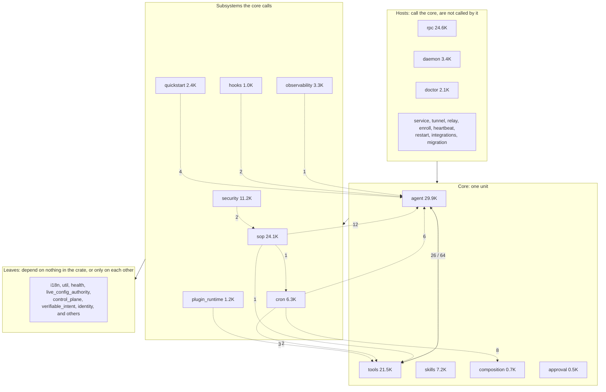
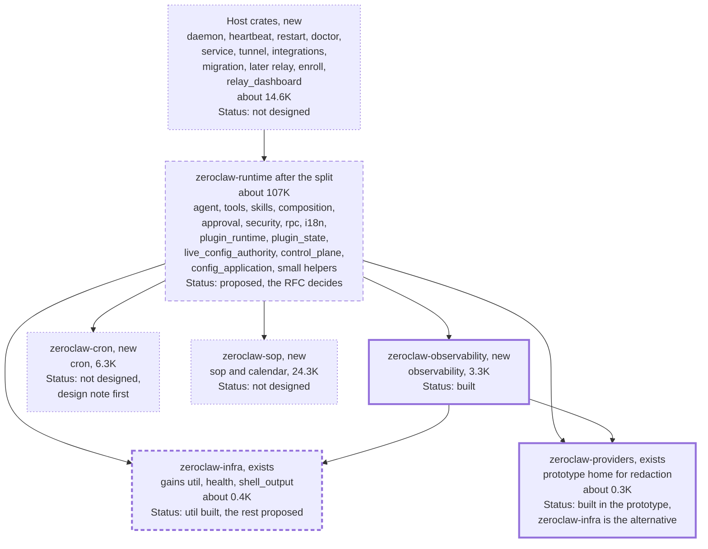

**The crate today.** Numbers in boxes are thousands of production lines. Solid arrows are the intended direction of calls. Dotted arrows are the 42 references that point the wrong way, each with its count. `agent` and `tools` refer to each other 26 and 64 times, which is why they stay together.

**The proposed split.** Arrows read "depends on". A thick border means built and compile-checked. A thick dashed border means partly built. A thin dashed border means proposed and not decided. A dotted border means not designed yet. About 4K lines (`quickstart`, `hooks`, `browse`, `routines`, `trust`) are left for later and not drawn.

