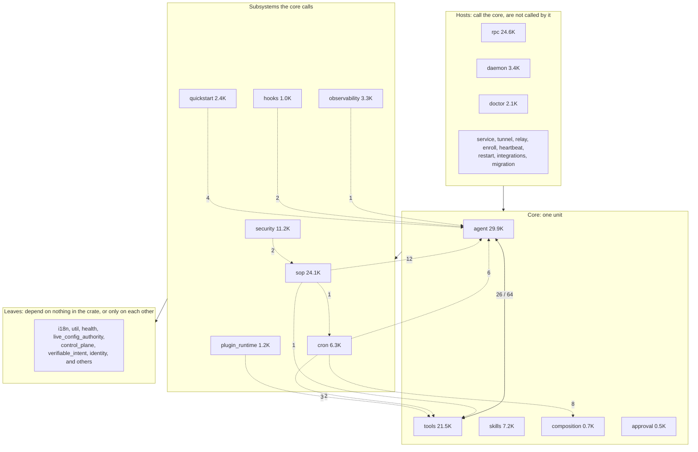
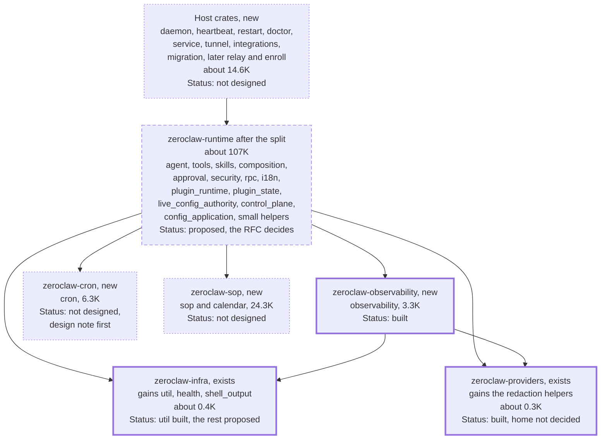

# Splitting `zeroclaw-runtime`: architecture, plan and proof

**Status: a proposal for discussion.** Measured at `master` commit `e02b7fb6f6` on 2026-11-22. Nothing here is
decided, and none of the code has been opened as a pull request.

Discussion, the open decisions and the pull request checklist are in the tracker issue:
<https://github.com/zeroclaw-labs/zeroclaw/issues/12697>.

## Start here

| Read | For |
|---|---|
| [`REPORT.md`](REPORT.md) | One screen: the recommendation, the first three pull requests, the open decisions, and what was not verified |
| [`PLAN.md`](PLAN.md) | The target layout, the governance question, the pull request sequence, the landing method, and what to do with #10557 |
| [`ARCHITECTURE.md`](ARCHITECTURE.md) | The crate as measured: its layers, its cycles, the 42 upward references, and where the exceptions cluster |
| [`REVIEW-LOG.md`](REVIEW-LOG.md) | Five adversarial review passes and what each one changed |

## The short version

- **The crate is three layers, not one knot.** It has 160,631 production lines. 42 references point up from seven
  subsystems into the core. `agent` and `tools` are one unit and stay together.
- **The exceptions come from two documents that disagree.** 55 of the 60 rows in the exception table send code to
  `zeroclaw-kernel`, a crate nothing schedules. Settling which modules may live in `zeroclaw-runtime` is a governance
  change and needs an RFC and a vote.
- **A move that does not edit the moved files breaks very few open pull requests.** Measured against all 588 open
  pull requests: moving `cron` byte-for-byte breaks 0 of the 23 that merge today, and the same move with path edits
  inside the files breaks 9. For `sop` it is 1 against 12.
- **The first three pull requests are built.** They move `util`, give credential redaction one owner, and extract
  `observability` into its own crate. Together they break 9 of the 112 open pull requests that touch those files.
  They compile in every configuration CI checks. Tests, clippy and rustdoc have not run on them.
- **`cron`, the hosts and `sop` are not ready.** `cron` needs a short design note first on who owns execution
  admission. The other two are marked not ready to schedule.

## The picture

**The crate today.** Numbers in boxes are thousands of production lines. Solid arrows are the intended direction of calls. Dotted arrows are the 42 references that point the wrong way, each with its count. `agent` and `tools` refer to each other 26 and 64 times, which is why they stay together.



**The proposed split.** Arrows read "depends on". A thick border means built and compile-checked. A dashed border means proposed and not decided. A dotted border means not designed yet. About 4K lines (`quickstart`, `hooks`, `browse`, `routines`, `trust`) are left for later and not drawn.



## How this was produced

- **Drafted by an AI coding assistant (Claude)** working from the repository at the commit above, for a maintainer who
  asked for a split whose pull requests merge within days.
- **Every number comes from a script in this folder** and can be re-run.
- **A second model reviewed it adversarially five times** (`gpt-6.2-astra`, in a read-only sandbox). The first pass
  was a BLOCK and was right on most findings; the documents were revised after each pass. The raw reviews are the
  `ASTRA-REVIEW-*.md` files.
- **It is a checked draft, not a decision.** `REPORT.md` lists what was not verified.

## What is in the folder

| File | What it is |
|---|---|
| `modgraph2.py` | Builds the module dependency graph of one crate from source text. Syntactic, not the compiler |
| `graph-e02b7fb6f6.json`, `.txt` | Its output at the measured commit |
| `exception-rows-e02b7fb6f6.json` | The 60 exception rows, parsed from `crates/zeroclaw-runtime/AGENTS.md` |
| `extract_module.py` | Moves a module to another crate without editing its files, and leaves a re-export behind |
| `widen_vis.py` | Widens `pub(crate)` to `pub` only where the compiler names an item |
| `prep_redact.py` | The redaction change that has to land before `observability` can move |
| `cargo_diag.py` | Reads a cargo run and says in one line whether it was clean |
| `check_retained.py` | Checks the runtime's retained-dependency list without running the test that enforces it |
| `regen_probe.sh` | Rebuilds the three commits from a clean checkout and runs every check |
| `regen-probe-final.log` | The log of the last full run, which reports `ALL CHECKS PASSED` |
| `probe-patches/` | The three commits as patches |
| `test_extract_module.py`, `test_cargo_diag.py` | 20 and 12 fixture tests for the two scripts above. They need only `python3` and `git` |
| `simmove.py` | Measures how many open pull requests a move would break, with `git merge-tree` |
| `open-prs-20261122.json` | The 588 open pull requests it measured, with each head commit |
| `simmove-results-e02b7fb6f6.json`, `.txt` | Its results per module |
| `exposure-stack-e02b7fb6f6.json`, `exposure-pr-list.txt` | The same measurement for the three real commits |
| `ASTRA-REVIEW-*.md` | The five reviews |

## Re-running it

Run these from the repository root with this branch checked out. `F` is this folder.

```bash
F=docs/maintainers/runtime-crate-split

# The module graph, on whatever commit is checked out
python3 $F/modgraph2.py crates/zeroclaw-runtime/src --json /tmp/graph.json

# The tests for the move script and the build checker
python3 $F/test_extract_module.py && python3 $F/test_cargo_diag.py

# The three commits, from the saved patches, on a scratch branch off this one
git switch -c runtime-split-try && git am $F/probe-patches/*.patch

# The three commits, regenerated from scratch in a clean detached worktree.
# Needs a Rust toolchain; about 12 minutes on 32 cores.
git worktree add --detach ../runtime-split-probe e02b7fb6f6
$F/regen_probe.sh e02b7fb6f6 ../runtime-split-probe
```

`simmove.py` is not parameterised. It has the worktree path, the pull request snapshot path and a temporary object
directory written at the top of the file, and it expects every open pull request head fetched to
`refs/rdp/pr/<number>`. Edit those constants before running it.

## Building on it

- **The numbers go stale.** They are for one commit. Re-run `modgraph2.py` on current `master` before relying on
  them.
- **A stale branch is regenerated, not rebased.** That is the point of the method: run `regen_probe.sh` on the new
  base.
- **The scripts are a proof, not repository tooling yet.** The last review blocks merging them as they stand and
  gives four conditions; they are listed in `PLAN.md` under Phase 0, with the known open defects. The scripts here are
  exactly what that review read.
- **The decisions are open.** `REPORT.md` lists six, starting with whether to open the governance RFC.
