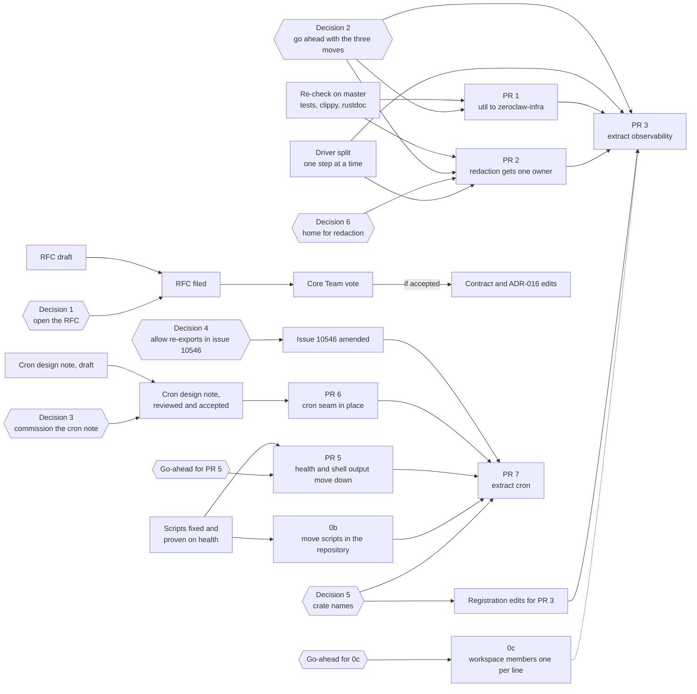

# Work plan for the runtime crate split

2026-11-25, for tracker #12697. `PLAN.md` says what to build and why. This says what happens next, in what order,
what each step waits on, and who is needed. It is a proposal: nothing here is decided, and it sets no dates because
those depend on reviewers.

## Short version

- **Four things can start now and need no decision:** re-check the three built moves on current `master`, draft the
  RFC text, draft the cron design note, and harden the move scripts. All four are local work; nothing is posted.
- **Three decisions unblock the first merges:** the go-ahead for the three moves (decision 2 in the tracker), the home
  for the redaction helpers (decision 6), and the crate name `zeroclaw-observability` (decision 5).
- **The RFC runs beside everything else** and gates none of the moves.
- **Cron does not start until its design note is accepted.** The hosts and SOP stay unscheduled.

## What waits on what

Hexagons are decisions people have to make. Boxes are work. A solid arrow reads "must come before". The dotted arrow
is a recommended order, not a requirement.

## Track A: land the three built moves

| Step | What | Waits on | Done when |
|---|---|---|---|
| A1 | Regenerate the three commits on the tip of `master` with `regen_probe.sh`, then run what has not run yet: the workspace tests, clippy and rustdoc with warnings denied, and the all-features check. Also compile PR 2 on its own, without PR 1 | Nothing | Every check is clean and the log is saved in the folder |
| A2 | Split the driver so each step can be regenerated alone. `regen_probe.sh` rebuilds all three as one stack and starts by moving `util`, so it cannot produce PR 2 without PR 1, or PR 3 once both have merged. It also stages only the manifests, `crates/` and one test fixture, so it has to learn the registration paths in A6 | Nothing | PR 2 and PR 3 can each be regenerated alone, and PR 3's run stages its registration edits |
| A3 | Open PR 1, `util` into `zeroclaw-infra` (5 files, +7/−2). It is a move, so the move-day checklist in `PLAN.md` applies from here on | A1, decision 2. The driver already builds this step on its own | Merged |
| A4 | Open PR 2, credential redaction gets one owner (7 files, +54/−52) | A1, A2, decisions 2 and 6 | Merged |
| A5 | Open 0c, workspace members one per line in the root `Cargo.toml` | Its own go-ahead: the tracker lists it in scope, but decision 2 names only the three moves | Merged, and `cargo metadata` output is unchanged |
| A6 | Write the registration edits PR 3 still lacks: the labeler, CODEOWNERS, the crate list and the stability table in the docs, and two CI scope scripts. The risk labeler has no `observability` rule, so it needs none | Decision 5 | In the PR 3 recipe |
| A7 | Open PR 3 as a draft early so the recipe can be reviewed. On the move day regenerate it on `master` and follow the move-day checklist | PR 1 and PR 2 merged, A6, decisions 2 and 5 | Merged |
| A8 | After each of the three merges, the same day: help the pull requests it breaks (1, 2 and 6 are predicted), and compare which pull requests GitHub now marks as conflicting against the prediction | Each of A3, A4 and A7 in turn | The prediction is confirmed or corrected in the folder |

- **`master` has moved 113 commits since the measurement** (to `badcc3da4d`, checked 2026-11-25). Twelve of them touch
  four of the 28 files the patches edit: `Cargo.lock`, `crates/zeroclaw-providers/src/lib.rs`, `agent/loop_.rs` and
  `agent/turn/mod.rs`. The three saved patches still apply to that commit without conflict. That is a textual check;
  A1 is what proves they still compile.
- **PR 1 and PR 2 can be open at the same time.** They share no file, and the PR 2 patch applies without PR 1. PR 2
  has only been compiled on top of PR 1, which is why A1 compiles it alone. If decision 6 picks `zeroclaw-infra`, check
  the overlap again, because both would then edit that crate.
- **PR 3 has to follow both.** The new crate depends on `zeroclaw-infra` for `util` and on `zeroclaw-providers` for
  redaction, and PR 2 edits a file that PR 3 moves. So PR 3 is regenerated after they merge.
- **If decision 6 picks `zeroclaw-infra`,** the redaction recipe changes: `scrub_secret_patterns` moves down too, and
  A1 is repeated for PR 2 and PR 3.
- **PR 3 may be over the plan's own size limit.** It is +100/−6 today, and the registration edits were estimated at
  about 55 lines. That is about 161 lines outside renames against a limit of 150. Measure the real figure. If it stays
  over, split the docs registration into a follow-up pull request.
- **0c before PR 3 is a recommendation.** All six of PR 3's predicted breaks are in the root `Cargo.toml`, and 0c
  should remove that conflict point. Two things follow if 0c lands first: `extract_module.py` has to be changed,
  because it writes the new workspace member onto the same line as the runtime's; and the six breaks have to be
  measured again on the real PR 3, because the effect of 0c was never simulated.
- **macOS and Windows** are only covered by the pull requests' own CI runs.
- **Owners to line up, from `.github/CODEOWNERS`:**

  | Path | Owners |
  |---|---|
  | `crates/zeroclaw-infra/**` | tidux |
  | `crates/zeroclaw-providers/**` | tidux, Audacity88 |
  | `crates/zeroclaw-runtime/**` | Audacity88 |
  | `Cargo.toml`, `Cargo.lock` | JordanTheJet |
  | `.github/labeler.yml` | Audacity88, IftekharUddin |
  | `.github/CODEOWNERS` | Audacity88, tidux, JordanTheJet |
  | `docs/**` | Audacity88, tidux |
  | `scripts/**` | Audacity88 |
  | `tests/**` | JordanTheJet, Audacity88 |

  `PLAN.md` says why a request is not enough: each path needs a named reviewer and a date before the move day.

## Track B: the governance RFC

| Step | What | Waits on | Done when |
|---|---|---|---|
| B1 | Draft the RFC from "The governance decision" in `PLAN.md`: the five options, the recommended one, and the five questions the documents leave open | Nothing | A draft a human sponsor is willing to file |
| B2 | File it as an `RFC:` issue | B1, decision 1, a human sponsor | Filed and linked from the tracker |
| B3 | Discussion, then a stable snapshot, then a Core Team vote | B2, and a Core contributor willing to open the vote | Accepted, returned for revision, deferred, or rejected |
| B4 | If accepted: amend `crates/zeroclaw-runtime/AGENTS.md` and ADR-016, and archive or trim the rows the decision retires (about 150 lines of docs) | B3 accepted | Merged |

- **It gates nothing in Track A.** Until the vote, the current exception process stays in force.
- **How the vote works** (`docs/book/src/contributing/rfcs.md`): a vote cycle normally stays open 72 hours. Quorum is
  two explicit ballots. The default threshold is two-thirds of the final active electorate. A valid `REVISE` stops the
  snapshot. Once quorum is met, any final `REJECT` rejects it. A vote short of quorum or threshold is deferred, and may
  enter another cycle.
- **An AI-drafted RFC has to say so in its body** and name the human sponsor, who is accountable for its accuracy
  (same file, "AI-authored RFCs"). Sponsoring it does not give a vote; only Core Team members cast ballots.

## Track C: the move scripts as repository tooling

| Step | What | Waits on | Done when |
|---|---|---|---|
| C1 | Fix the scripts against the review's four conditions (`PLAN.md`, Phase 0), with regression fixtures for each | Nothing | The fixtures pass |
| C2 | Prove them on a second module: `health` into `zeroclaw-infra`. It uses the move-into-an-existing-crate path, which is where two of the known defects are | C1 | It compiles in every configuration A1 checks |
| C3 | Add the tripwire that fails when a held module gains a new upward reference | C1 | It passes on `master` and fails on a planted reference |
| C4 | Open 0b with the scripts, their tests in CI, and the tripwire | C1 to C3 | A fresh review approves the scripts for merge during the pull request's review, and it is merged |

- **0b does not gate PRs 1 to 3.** Their recipe can be reviewed from the public folder. It does gate PR 7 and every
  later scripted move.
- **The tripwire needs a list of held modules.** Until the RFC decides, that is the list this plan proposes. If the
  RFC narrows the resident list, more modules are held and the tripwire covers more.

## Track D: cron

| Step | What | Waits on | Done when |
|---|---|---|---|
| D1 | Draft the design note on who owns execution admission. It chooses between an admission port, moving `live_config_authority` below cron, and leaving cron in the runtime. It should cover SOP's case too | Nothing for the draft; decision 3 before it goes to review | Reviewed and accepted. Who accepts it is for the maintainers to say; the reviewers of #10557 know its invariants best |
| D2 | Amend #10546 so a re-export may stay at the old path | Decision 4 | The issue text is changed |
| D3 | Pull request 5: `health` and shell-output decoding move down into `zeroclaw-infra`. `health` goes by script. `tools/shell_output.rs` is a file inside `tools`, not a top-level module, so it needs a small recipe of its own, like the redaction one | C2 for `health`; its own go-ahead | Merged |
| D4 | Pull request 6: the seam, in place, with no file moves. It carries `risk:high` and `domain:security`, so it needs two Core Team approvals. It says `Supersedes #10557` | D1 accepted | Merged |
| D5 | Close #10557 with a comment naming pull request 6 | D1 accepted and D4 open | Closed |
| D6 | Pull request 7: extract `cron` by script. It says `Supersedes #10557` | D3 merged, D4 merged, C4 merged, D2, decision 5 for the name `zeroclaw-cron` | Merged |
| D7 | Pull request 8: the precondition gate from #10557, in the new crate. It says `Supersedes #10557` | D6 | Merged, then #10546 closes |

- **D1 can end the track.** One of its options is to leave cron where it is.
- **D3 is a real prerequisite of D6.** `cron` refers to `health` six times and to the shell-output decoder twice. Both
  have to sit below the new crate before `cron` can.
- **D4 is the one change that edits the cron files themselves,** which 35 open pull requests touch. Its size is unknown
  until D1.
- **#10836** is an open draft holding the ownership fix that #10557 had folded in. It lands on its own or inside D4.

## Track E: hosts and SOP

Not scheduled.

- **E1: probe `tunnel`** (2.2K lines, used by nothing else in the crate, no open pull requests) to get a first
  measurement of what an upward move costs. It is local work. It does not settle whether `doctor` can move while `rpc`
  calls into it, and it says nothing about SOP's design.
- **SOP waits for cron to land,** because cron tests the same admission seam on a module a quarter the size.

## Who is needed

| Need | From |
|---|---|
| Decisions 1 to 6 in the tracker | The maintainers; crate names need a Core Team nod |
| A human sponsor for the RFC, named in its body | Anyone willing to be accountable for it |
| An author for each pull request, who answers its review | Whoever opens it |
| A named reviewer and a date for each touched path, before each move day | The code owners listed under Track A |
| The RFC vote | The Core Team |
| Review of the cron design note | For the maintainers to say; see D1 |

## Suggested order

1. A1, A2, B1, C1 and the D1 draft, in parallel. None is public.
2. Decisions 2 and 6, then PR 1 and PR 2. 0c when it has its go-ahead.
3. Decision 1, then file the RFC.
4. Decision 5 and A6, then PR 3 on a move day.
5. Decision 3, then the cron design note goes to review.
6. 0b, once C1 to C3 are done.
7. Cron pull requests 5 to 8, as the note allows.

## What could change this plan

- **A1 fails.** A test, clippy or rustdoc failure in the three moves is fixed in the recipe and the stack is
  regenerated. Nothing is opened until it is clean.
- **Reviewers are slow.** #10557 waited 28 days for a review requested on day one. A move with no dated reviewer does
  not get a move day.
- **The RFC narrows the resident list.** Then more modules are held and more exception rows stay. Tracks A and D are
  unaffected; the tripwire in Track C follows the new list.
- **The cron note chooses to leave cron in the runtime.** Track D stops after D3, and #10546 closes as not planned.
